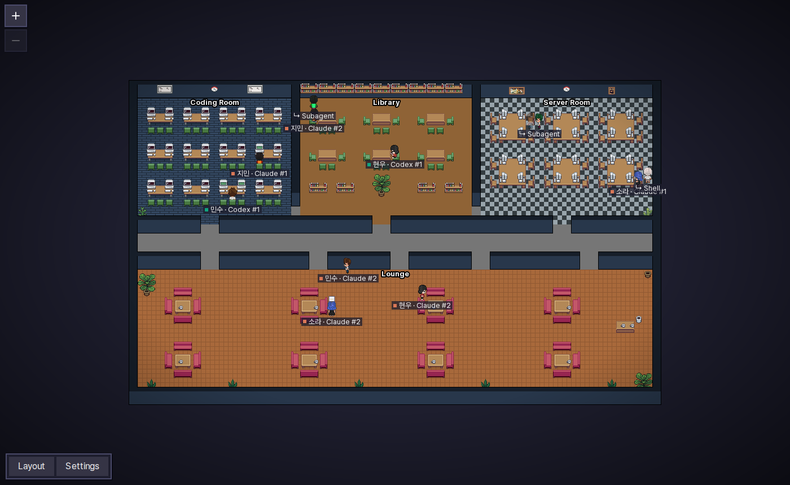
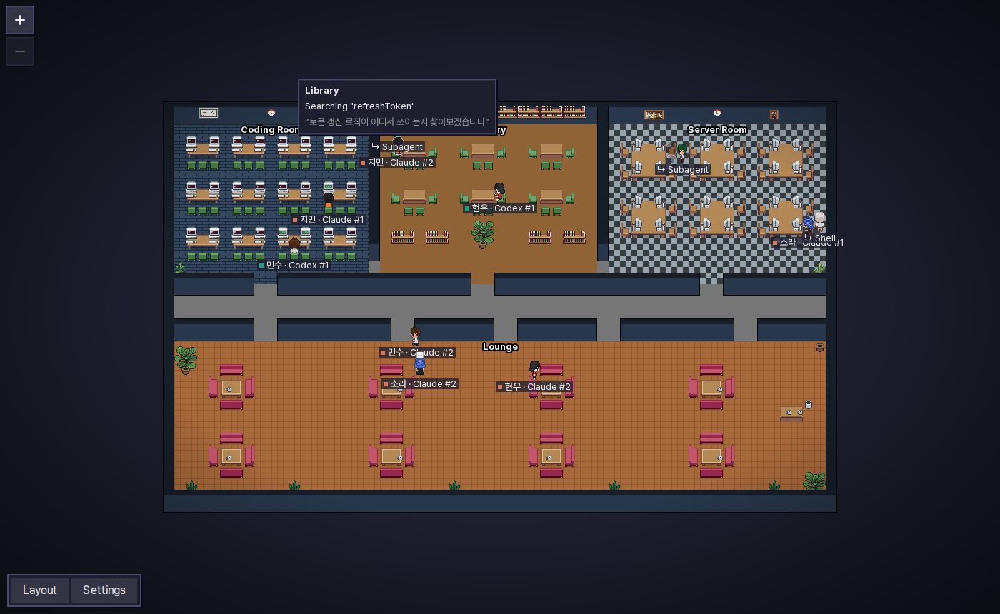

<h1 align="center">Pixel Office LAN</h1>

<p align="center">
  <a href="README.md">한국어</a> · <b>English</b>
</p>

<p align="center">
  See the AI coding agents of everyone on your local network (LAN)<br>
  together in <b>one pixel-art office</b>.
</p>

<p align="center">
  <a href="https://github.com/YOOJUNGYU/pixel-office-lan/releases/latest"><b>⬇️ Download</b></a> ·
  <a href="docs/INSTALL.en.md">Install guide</a> ·
  <a href="#whats-different-from-pixel-agents">vs. pixel-agents</a> ·
  <a href="#how-it-works">How it works</a> ·
  <a href="#development">Development</a>
</p>



At a glance you see who (PC account name and nickname), with which agent (Claude Code / Codex), in which room, is doing what. Install it from a single installer and it finds the other PCs on the same network by itself, **with no server**; everyone's agents meet in one office.

> A fork of [pixel-agents](https://github.com/pixel-agents-hq/pixel-agents) (MIT) with LAN sharing added. The original shows only the agents on your own PC.

## What's different from pixel-agents

The original [pixel-agents](https://github.com/pixel-agents-hq/pixel-agents) shows the Claude Code agents of **one PC** in a VS Code panel or a browser. Pixel Office LAN turns it into **an office the whole team on the network shares**.

|                     | pixel-agents (original)                                     | Pixel Office LAN                                                                                                                                                                                                                     |
| ------------------- | ----------------------------------------------------------- | ------------------------------------------------------------------------------------------------------------------------------------------------------------------------------------------------------------------------------------ |
| Scope               | Agents on your own PC                                       | Agents of **every installed PC on the network**, in one office                                                                                                                                                                       |
| Sharing             | None (at most, opening your own screen in a browser)        | **Serverless P2P**: PCs find each other; anyone can shut down without affecting the rest                                                                                                                                             |
| Transport security  | n/a                                                         | **Automatic encryption** between PCs (X25519 key agreement + AES-256-GCM), impersonation detection                                                                                                                                   |
| Groups              | None                                                        | **Team offices**: private offices visible only to people with the invite code                                                                                                                                                        |
| Agents              | Claude Code                                                 | Claude Code **+ Codex** (CLI · Desktop · VS Code extension)                                                                                                                                                                          |
| Install             | VS Code extension / `npx` (needs Node)                      | **One installer** (Windows `.exe` · macOS `.pkg`, Node bundled); **WSL sessions are read from Windows too**                                                                                                                          |
| Detection           | Installs Claude hooks (edits `settings.json`) + transcripts | **Reads transcripts only** — never touches the tools' settings                                                                                                                                                                       |
| Character placement | Fixed seat, state shown by animation                        | **Walks between rooms by activity** (Coding Room · Library · Server Room · Lounge)                                                                                                                                                   |
| Activity            | Status text                                                 | Two-line name tag (`account (nickname)` / `Claude #1`) + **hover bubble** (which file and why, what it searches)                                                                                                                     |
| Privacy             | n/a                                                         | **Hide details** (on by default): paths, IPs, tokens and command arguments never leave the PC                                                                                                                                        |
| Your character      | Auto-assigned                                               | **Six people or a pet (Claudio · Gitcat)** + color (people keep their skin tone), optional nickname; the name is the PC account                                                                                                      |
| Language · font     | English · pixel font                                        | **Korean/English** per viewer, **Pretendard**                                                                                                                                                                                        |
| Map controls        | Middle-button pan, integer zoom                             | **Drag to pan + smooth wheel zoom**                                                                                                                                                                                                  |
| Layout              | Floors, walls, furniture, areas                             | + **background outside the map** (solid · tiles · carpet), **four fixed rooms**, a fixed **90×60** office, fitted to the screen at first, edits never move characters · layouts are **per PC** (share by exporting/importing a file) |
| App-like use        | —                                                           | **Installable PWA** (install popup), shortcut opens the app window, optional start at login                                                                                                                                          |
| Updates             | Marketplace / npm                                           | In-app **Update button** (GitHub Releases)                                                                                                                                                                                           |
| Who is online       | —                                                           | **People panel**: people without agents too; click to jump to them                                                                                                                                                                   |
| First run           | —                                                           | **Onboarding tour** that walks through every feature on the real UI                                                                                                                                                                  |

On the other hand, the original's **agent launching, terminal attach and VS Code extension** were removed. This app focuses on _watching_; agents keep running in whatever CLI or desktop app each person already uses.

## Features

### Agents move between rooms by what they do

When an agent switches activity, its character walks to the matching room. So that agents switching tools every few seconds don't make the screen hectic, a character only moves once the same activity has lasted 3 seconds. Inside a room nobody wanders: characters sit on a free seat (or stand still when there is none). The plate at each room's top left counts its main agents, `+N` its subagents and shells (e.g. `Coding room 5 · +3`). The **Rooms** legend at the top left (under the theme and zoom buttons, folds away) shows which activity goes to which room. Character name tags start hidden and appear when you hover a character; the **Show name tags** button below it keeps them on (remembered per browser).

| Room           | Activity                                                   |
| -------------- | ---------------------------------------------------------- |
| 🖥️ Coding Room | Editing files (Claude `Edit`/`Write`, Codex `apply_patch`) |
| 📚 Library     | Reading files, searching code, web search / viewing pages  |
| 🗄️ Server Room | Running commands (`Bash`, Codex shell)                     |
| 🛋️ Lounge      | Waiting for input or an answer, turn finished              |

### Name tags and hover bubbles

- Every character carries a tag: two lines, `account (nickname)` (or just `account`) over `Claude #1` / `Codex #1`. The account is the PC login name (cannot be changed); the nickname shows only when set.
- Hover a character to see **what it is doing right now**: which file it is editing and why, what it is searching for, which command it runs.
- A **red !** appears above an agent that is waiting for a person.
- Main agents' name tags end with a **MAIN** badge; subagent and shell name tags are the parent's name tag with a **SUB** / **SHELL** badge.



### Subagents and shells hold hands

- **Subagents** and **background shells** running inside a session get their own characters.
- In the **same room** as their parent they walk in a line holding the parent's hand.
- In a **different room** they do not hold hands: each stays in that room according to its own state.

### Serverless LAN sharing

- Every installed PC announces its agents' state to the network once a second and collects everyone else's to draw the office.
- **There is no server.** When someone shuts down their PC, only their characters disappear after a few seconds; everyone else is unaffected.
- PCs on the same network appear automatically, no IP needed. Only when they can't (different floors or VLANs), add the other PC's IP under **Settings → My profile → Advanced: when a PC isn't found automatically**.
- Everything PCs exchange is **encrypted** (see [Encryption](#encryption)). Nothing to set up.
- The UI opens **only in the browser on your own PC** (`http://localhost:47801`). There is no watching from another PC's browser; install the app there instead.

### Public and team offices

Switch the office you are looking at with the office switcher at the top of the screen.

- 🌐 **Public office** (default): everyone on the network who installed the app. No setup.
- 🔒 **Team office**: a room only people with its invite code can see. You can be in several at once.
  - **Create**: in **Settings → Offices → Create a team office**, enter a team name (1–20 chars) and press **Create**. You get an invite code like `PO2-XXXX-…`; **Copy code** and send it to your teammates (chat, mail, …). Copy it again later from **Your team offices**.
  - **Join**: paste the code under **Settings → Offices → Join with a code** and press **Join** (the team name is optional; if empty, the name a member announces is used).
  - **Leave**: **Leave** in the list. You need the code to come back.
- ⚠️ **While you are in any team office you leave the public office completely**: you neither send to nor see the public office (so nobody can quietly watch the public office from inside a team). To return to the public office, leave all team offices.
- If a code leaks, create a new team office and move. The code itself never goes on the network.
- 🏠 **Personal**: press **Personal** in the switcher at the top to use a small office of your own (34×22, 8 seats per room) that **exchanges nothing** with other PCs (nothing sent, nothing received). No other PC sees you and you see only your own agents; a chat bubble stays on your screen. It has its own layout (`layout-personal.json`), so editing it leaves the shared office as it was. Your team offices are kept: press **Public office** or a team button to go straight back, no code needed. Personal mode survives a restart.

### Encryption

| Office | How                                                                                                                                                                                                     |
| ------ | ------------------------------------------------------------------------------------------------------------------------------------------------------------------------------------------------------- |
| Public | Every PC creates an X25519 key pair automatically. Two PCs that find each other agree on a key for the pair, encrypt with **AES-256-GCM** and send **only to that PC**. Only public keys are broadcast. |
| Team   | Encrypted with **AES-256-GCM** under a key derived from the invite code. Only a short tag identifying the team goes on the wire, never the code (secret).                                               |

- A PC's public key is remembered the first time it is seen; a different key under the same PC id is ignored (anti-impersonation). Replayed packets are dropped.
- **Limits**: the public office stops eavesdropping, but cannot stop someone who installed the app (or mimics the protocol) from joining. To choose who joins, use a team office. A team office is only as safe as its code.
- v0.2.0 does not talk to v0.1.0 (old unencrypted packets are ignored). Update every PC to 0.2.0 or later.

### Security and privacy

- Only **read-only state** is shared. Nobody can reach your terminals, run your agents, or change your settings; write actions are accepted only from the browser on your own PC.
- **Hide details** (on by default): file paths, user names, IPs and hostnames, URL paths, and token- or password-like strings, and the AI's reply text (the reason), **never leave your PC**. Commands are sent as the program name only (or Claude's own description). Your own screen still shows your agents verbatim.
- Your PC login account name is the name tag, so other PCs always see it (hide details does not apply).
- Claude Code and Codex settings are **never modified**; the app only reads the transcript files these tools already write.

### And more

- 📲 **Install as an app (PWA)**: open the office in this PC's browser and an **Install Pixel Office as an app** popup appears top right. **Install** (Edge/Chrome) installs it as a tab-less app window, and the Windows shortcuts then open that app (a Mac opens the default browser). **Later** hides it for 7 days. Safari: **Share → Add to Dock / Add to Home Screen**; Firefox can't install apps.
- 👤 **Profile**: on first run pick a character (six people or the pets **Claudio · Gitcat**) and a color (8 swatches + slider), and optionally a nickname. People keep their skin tone while clothes and hair change color; a pet's body changes color. Subagents are the same pet in a slightly shifted color. 0.4.x PCs show pets as people. Your PC login account name always shows first and cannot be changed.
- Nicknames must be unique (ignoring case and spaces): saving one that another PC you can see uses is refused. If two PCs picked the same one while apart, **whoever set it first keeps it**; the later one shows with a short tag (`Mina · a1b2`) and gets a one-time prompt to change it.
- 🌐 **한국어 / English**: each viewer chooses (Settings → Language). Text the agent wrote itself (reasons, file names, commands) is shown as-is.
- 🌗 **Dark / light theme**: each viewer chooses (Settings → Theme; `System` follows the OS), or switch dark/light in one click with the sun/moon button at the top left. Dark is the default; light brightens the UI and the office itself (floors, corridor, walls, furniture, outside background). Characters and pets keep their colors, and the saved layout colors are not changed.
- 🖱️ **Map controls**: drag an empty spot to pan; the mouse wheel (or trackpad pinch) zooms smoothly around the cursor; the + / − buttons at the top left work too.
- 🔄 **Updates**: checked once when the app starts (check again any time with **Settings → Check for updates**); when a new version is on GitHub Releases, an **Update** button appears at the top right; it downloads and runs the installer, and the open window reloads itself into the new version (no second window).
- 🏗️ **Layout editor** (from the original): paint floors and walls and place furniture. The four rooms (Coding Room · Library · Server Room · Lounge) come with the default office and cannot be repainted; a room left with no walkable tile is warned about. The **Background** tab fills the area around the office with a solid colour, a floor pattern or a carpet. The office is **fixed 90×60** (a 128×128 layout saved by 0.6/0.7 keeps working; **Settings → Reset to the default office** switches to the 90×60 one); it is fitted to the screen when first opened. While editing, Undo · Redo · Save · Reset sit next to the **Layout** button. **Click a room with the floor tool and the whole room is painted at once** (outside rooms: the connected corridor floor; one click = one undo step). **Save** saves and closes the editor; **Reset** asks first, then restores the default office and closes the editor. Changing the layout never moves the characters.
- 🗺️ **Layouts are per PC.** In the public office and in team offices alike, your edits are saved right away **on this PC only**; nobody else's screen changes. To use the same layout, hand over a file from **Settings → Export layout**; the other person opens it with **Import layout**.
- 👥 **People panel**: the right edge lists everyone connected to the office you are viewing, including people with no agents, with their Claude/Codex agent counts and status (❗ needs attention, working, idle). Click a name to move the camera to their agent.
- 💬 **Chat**: press `/` over the map and a text box opens at the mouse pointer. Type and press **Enter**: a bubble with your name is pinned to that spot for everyone viewing the same office (public, or the team office you are in). Everyone has **one bubble**: a new one replaces the old one (at the new spot), and the **×** on yours deletes it. It disappears for others when your PC goes offline or leaves that office, and comes back when it starts again (only your current bubble is kept, in this PC's `profile.json`; there is no history). **Esc** or a click elsewhere cancels the input and leaves your bubble as it was. Up to 100 characters, one message per 2 seconds; the spot is a tile position, so it stays put when the map is panned or zoomed. PCs on 0.7.3 or older do not see it.
- 🔔 **PC notifications** (Windows/Mac; they come with the window closed too, as long as the tray icon runs): two separate toggles in Settings, both on by default. Windows/macOS may ask you to allow notifications first; on a Mac they may show under "Script Editor"/"osascript". On Linux/WSL they only go to the log.
  - **Join/leave**: while you are in the public office, "yoojungyu (nickname) joined" or "… left" ("3 people joined" when several change at once). A leave is shown only after the PC has been gone for 10 seconds, and nobody already there within 5 seconds of starting or switching offices is announced. Team offices and personal mode show none.
  - **My agents**: when one of this PC's Claude/Codex agents waits for your answer (approval), "Claude #1 is waiting for you (npm test)"; when it finishes, "Claude #1 finished its work". Once per wait and once per finished turn; nothing for agents already in that state at start or for a session that is just closed, and none for subagents. In every office, personal mode included.
- 🧭 **Onboarding tour**: on first run it spotlights the real UI one part at a time (the rest dimmed) and shows every feature live — rooms, bubbles, offices, settings and the layout editor. Replay it any time from **Settings → Replay tour**.

## Supported environments

|               | Supported                                                                       |
| ------------- | ------------------------------------------------------------------------------- |
| OS            | Windows 10/11 (64-bit), macOS (Apple silicon, Intel)                            |
| Agents        | Claude Code: Windows native · WSL · Mac / Codex CLI: Windows native · WSL · Mac |
| Prerequisites | None. The Node.js runtime ships inside the installer.                           |

Claude Code and Codex running inside WSL are read by the Windows app; there is nothing to install inside WSL. Only running WSL distributions are read, so an idle WSL is never woken up.

## Install

1. Download the file for your PC from [Releases](https://github.com/YOOJUNGYU/pixel-office-lan/releases/latest).

   | PC                         | File                                |
   | -------------------------- | ----------------------------------- |
   | Windows                    | `PixelOffice-<version>-Windows.exe` |
   | Mac (Apple silicon, Intel) | `PixelOffice-<version>-Mac.pkg`     |

2. Run it. It is a free project without code signing, so you will see a warning:
   - **Windows**: "Windows protected your PC" → **More info** → **Run anyway**, then User Account Control → **Yes**
   - **Mac**: if blocked, **System Settings → Privacy & Security → Open Anyway**; if the firewall is on, "Allow incoming connections"
3. The office opens in your browser; choose a character and a colour (a nickname is optional).

### How to open

- **Start at login** — on by default. On Windows you can untick it in the installer; anytime, toggle **Settings → Start at login**.
- **Quitting** — the Pixel Office icon in the tray (Windows notification area, Mac menu bar) → **Quit Pixel Office**, or **Settings → Quit Pixel Office**. **Open Pixel Office** on the icon (a left click on Windows) opens the window.
- **Windows**: the **Pixel Office** desktop shortcut ("Create a desktop shortcut" in the installer) or Start → **Pixel Office 열기**. It starts the office if needed and opens **the installed app** (Edge, else Chrome) if you installed it, otherwise a new Edge (or Chrome) window where the install popup appears, otherwise the default browser.
- **Mac**: **Pixel Office** in **Applications** or **Launchpad** (no desktop alias, following macOS convention)
- Anywhere: `http://localhost:47801` in a browser

### Updating from 0.4.x

- Settings and layouts are kept. Decorative pets in old layouts are removed (pets are now chosen as characters), and room areas are tidied into the four fixed rooms.
- Layouts stay per PC, as before.
- 0.4.x PCs can't see a PC with very many agents and show pets as people. Update every PC on the network.

Details, what to do when other PCs don't show up, and how to uninstall: **[Install guide](docs/INSTALL.en.md)**.

> If corporate security software (EDR, AppLocker, …) blocks it, ask your IT team for an exception.

## How it works

```
 [My PC]                                          [Teammate's PC]
 Claude / Codex transcripts ─▶ reporter ─┐     ┌─ reporter ◀─ transcripts
  (~/.claude, ~/.codex, WSL)              │ UDP │
                                          ├◀───▶┤   encrypted state every second (no server)
 browser ◀── WebSocket ── local server ◀──┘     └▶ local server ── WebSocket ──▶ browser
(app win) http://localhost:47801                          http://localhost:47801 (app win)
```

- The **reporter** reads sessions changed in the last 30 minutes under `~/.claude/projects` and `~/.codex/sessions` (and the same places in running WSL distributions). A Claude session leaves within seconds once its process (`~/.claude/sessions/<pid>.json`) has exited, i.e. you closed it; a session that can't be checked (an older Claude without that file, one running in another process namespace such as the Claude desktop app, or Claude run natively on Windows/macOS) stays up to 30 minutes after its last line. A Codex session leaves 10 minutes after its turn finished (30 while working).
- It turns each line into `{room, act, target, reason}` and applies the hide rules.
- On UDP port **47800** it broadcasts a hello carrying only its public key, and sends the state **encrypted**: to each discovered PC separately for the public office (pair keys), under the team key for team offices. While in a team office it sends neither hellos nor public-office state.
- The **local server** (HTTP **47801**) merges your state with what it received for the office you are viewing and streams it to the browser, which renders sentences in the viewer's language. It listens on `127.0.0.1` only, so other PCs cannot connect.
- The browser's service worker caches only the page files (for app install); office state (`/ws`) and `/api` are never cached.
- Every UDP datagram is **at most 1200 bytes** (for networks and VPNs that drop fragmented packets). A state that fits one datagram goes in the old (0.4.x) form; a larger one (many agents) is compressed, split into up to 48 encrypted parts and reassembled by the receiver. If a part is lost, the previous state stays until the next send (a second later).
- Layouts (office arrangements) are never sent over the network.
- A PC that has been silent for 5 seconds disappears from the office.

| Port      | Purpose                                                                |
| --------- | ---------------------------------------------------------------------- |
| UDP 47800 | State exchange between PCs (encrypted; broadcast + manually added IPs) |
| TCP 47801 | Browser UI (`http://localhost:47801`, this PC only)                    |

Data is stored only in `~/.pixel-office/` (profile, keys and team codes, layout (`layout.json`, `layout-personal.json` for personal mode, this PC only), remembered PC public keys, downloaded updates). Files holding keys and codes are readable by you only (0600).

## Known limitations

- Broadcasts reach **only the same subnet**. Across subnets, add PC IPs under **Settings → My profile → Advanced: when a PC isn't found automatically**.
- Codex doesn't record approval requests, so ❗ for Codex appears only when it asks you a question. Codex subagents are not yet verified against real transcripts.
- Hide details filters paths, addresses and token shapes and does not send the AI's reply text at all, but may not catch every password fragment written inside a command or search pattern.
- The public office cannot stop people who installed the app from joining.
- There is no watching from another PC's browser without the app (remote viewing was removed in v0.4.0).
- v0.1.0 PCs and 0.2.0 PCs don't see each other; everyone needs 0.2.0 or later.
- **0.4.x PCs** can't see a PC with very many agents (a state larger than one datagram) and show pets as people. Update every PC.
- Layouts are not shared automatically; exchange an exported file to use the same one.
- Characters whose outfits are near-greyscale barely change with the color setting.
- Performance: the office redraws only when something changes. Headless Chromium, main-thread time per 10 s: empty office ~3.8 s → 0.13 s (−97%), 20 PCs × 5 agents seated ~4.4 s → 1.1 s (−76%; only typing/monitor animation frames are drawn), walking unchanged (every frame). The server uses ~1% CPU and ~100 MB with 20 PCs connected.

## Development

```bash
npm install
npm run build              # dist/ — cli.js bundles its dependencies (runs without node_modules)
node dist/cli.js --open    # http://localhost:47801
npm test                   # server + webview (Vitest)
npm run check-types && npm run lint
```

| Path               | Contents                                                                                         |
| ------------------ | ------------------------------------------------------------------------------------------------ |
| `core/`            | Protocol (`asyncapi.yaml` → generated `messages.ts`), shared LAN types (`lan.ts`)                |
| `server/src/lan/`  | Reporter: transcript scanner, Claude/Codex parsers, session state, redaction, UDP peers, updater |
| `server/src/`      | Fastify HTTP/WebSocket server, CLI, layout and assets                                            |
| `webview-ui/`      | React + Canvas office, name tags and bubbles, profile, i18n                                      |
| `scripts/package/` | Windows (Inno Setup) and macOS (pkgbuild) installers                                             |

- Architecture and conventions: [CLAUDE.md](CLAUDE.md). Design and implementation plan: [docs/superpowers/](docs/superpowers/).
- **Release**: bump `version` in `package.json` and push a `v<version>` tag; GitHub Actions builds the three installers and attaches them to a Release. Tags containing `-` are published as pre-releases.

## Credits

- Original: [pixel-agents](https://github.com/pixel-agents-hq/pixel-agents) (MIT). The office engine, layout editor and furniture assets come from it.
- Characters: [JIK-A-4, Metro City](https://jik-a-4.itch.io/metrocity-free-topdown-character-pack)
- Font: [Pretendard](https://github.com/orioncactus/pretendard) (SIL OFL 1.1)

<p align="center">
  
</p>

## License

[MIT](LICENSE). The original pixel-agents copyright notice is retained.
