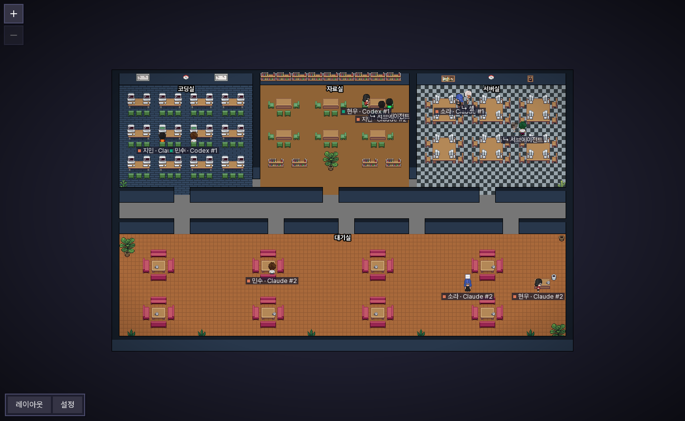
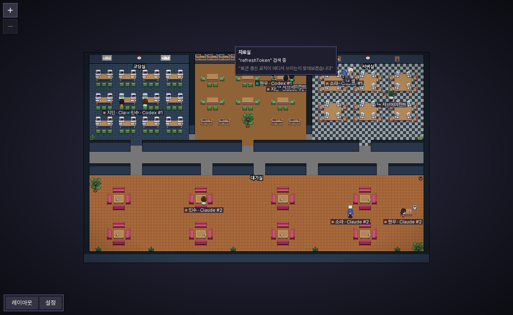

<h1 align="center">Pixel Office LAN</h1>

<p align="center">
  <b>한국어</b> · <a href="README.en.md">English</a>
</p>

<p align="center">
  같은 사내망(LAN)에서 일하는 모든 사람의 AI 코딩 에이전트를<br>
  <b>하나의 픽셀 사무실</b>에서 함께 보는 앱입니다.
</p>

<p align="center">
  <a href="https://github.com/YOOJUNGYU/pixel-office-lan/releases/latest"><b>⬇️ 설치 파일 받기</b></a> ·
  <a href="docs/설치-안내.md">설치 안내</a> ·
  <a href="#pixel-agents와-무엇이-다른가">원작과 다른 점</a> ·
  <a href="#동작-방식">동작 방식</a> ·
  <a href="#개발">개발</a>
</p>



누가(PC 계정 이름 · 닉네임) · 어떤 에이전트(Claude Code / Codex)가 · 어느 방에서 · 무엇을 하고 있는지 한눈에 보입니다. 설치 파일 하나로 설치하면 같은 망의 다른 PC를 **서버 없이** 저절로 찾고, 모두의 에이전트가 한 사무실에 모입니다.

> [pixel-agents](https://github.com/pixel-agents-hq/pixel-agents)(MIT)를 포크해 LAN 공유 기능을 더한 프로젝트입니다. 원작은 내 PC의 에이전트만 보여 줍니다.

## pixel-agents와 무엇이 다른가

원작 [pixel-agents](https://github.com/pixel-agents-hq/pixel-agents)는 **내 PC 한 대**의 Claude Code 에이전트를 VS Code 패널이나 브라우저에 보여 주는 도구입니다. Pixel Office LAN은 이것을 **같은 망의 팀 전체가 함께 보는 사무실**로 바꿨습니다.

| 구분          | pixel-agents (원작)                               | Pixel Office LAN                                                                                                                                                                                |
| ------------- | ------------------------------------------------- | ----------------------------------------------------------------------------------------------------------------------------------------------------------------------------------------------- |
| 보는 범위     | 내 PC의 에이전트만                                | **같은 망의 모든 설치 PC** 에이전트를 한 사무실에                                                                                                                                               |
| 공유 방식     | 없음 (브라우저로 내 화면을 열어 주는 정도)        | **서버 없는 P2P**: PC끼리 자동 발견, 누가 꺼져도 나머지는 그대로                                                                                                                                |
| 통신 보안     | 해당 없음                                         | PC 간 **자동 암호화** (X25519 키 교환 + AES-256-GCM), 사칭 감지                                                                                                                                 |
| 그룹          | 없음                                              | **팀 오피스**: 초대 코드를 아는 사람끼리만 보이는 비공개 사무실                                                                                                                                 |
| 지원 에이전트 | Claude Code                                       | Claude Code **+ Codex** (CLI · Desktop · VS Code 확장)                                                                                                                                          |
| 실행 환경     | VS Code 확장 / `npx` (Node 필요)                  | **설치 파일 하나** (Windows `.exe` · macOS `.pkg`, Node 내장), **WSL 세션도 Windows에서 함께** 읽음                                                                                             |
| 상태 감지     | Claude 훅 설치 (`settings.json` 수정) + 기록 파일 | **기록 파일만 읽음** — 각 도구의 설정을 건드리지 않음                                                                                                                                           |
| 캐릭터 위치   | 고정 좌석, 동작으로만 상태 표시                   | **하는 일에 따라 방 이동** (코딩실·자료실·서버실·대기실)                                                                                                                                        |
| 활동 표시     | 상태 문구                                         | 이름표(`계정 (닉네임) · Claude #1`) + **말풍선**(어떤 파일을 왜 고치는지, 무엇을 검색하는지)                                                                                                    |
| 서브에이전트  | 부모 옆에 등장                                    | **손잡고 줄지어** 다니고, 다른 방이면 **부모의 반투명 분신**이 이끎 · **백그라운드 셸**도 캐릭터로, 이름표는 부모 이름 + **SUB / SHELL 배지**                                                   |
| 개인정보      | 해당 없음                                         | **상세 숨기기**(기본 켜짐): 경로·IP·토큰·명령 인자를 PC 밖으로 내보내지 않음                                                                                                                    |
| 내 캐릭터     | 자동 배정                                         | **사람 6종 또는 펫(Claudio · Gitcat)** + 색상(사람은 피부색 유지), 선택 닉네임, 이름은 PC 계정으로 고정                                                                                         |
| 언어 · 글꼴   | 영어 · 픽셀 글꼴                                  | **한국어/English** (보는 사람마다), **Pretendard**                                                                                                                                              |
| 지도 조작     | 가운데 버튼 이동, 정수 배율                       | **드래그 이동 + 휠로 부드러운 확대·축소**                                                                                                                                                       |
| 레이아웃      | 바닥·벽·가구·영역                                 | + **맵 바깥 배경**(단색·타일·장판), **고정된 방 4개**, **128×128** 고정 크기, 처음엔 화면에 맞춤, 편집해도 캐릭터가 움직이지 않음 · 배치는 **PC마다 따로**(공유하려면 파일로 내보내기/가져오기) |
| 앱처럼 쓰기   | —                                                 | **PWA 설치**(설치 팝업), 바로가기가 앱 창으로 실행, 로그인 시 자동 실행(선택)                                                                                                                   |
| 업데이트      | 마켓플레이스 / npm                                | 앱 안의 **업데이트 버튼** (GitHub Releases)                                                                                                                                                     |
| 누가 접속했나 | —                                                 | **접속자 패널**: 에이전트 없는 사람까지, 클릭하면 그 사람에게 이동                                                                                                                              |
| 처음 사용     | —                                                 | **온보딩 투어**: 실제 화면을 짚어 가며 모든 기능 안내                                                                                                                                           |

반대로 원작의 **에이전트 실행·터미널 연결·VS Code 확장**은 이 포크에서 뺐습니다. 이 앱은 "보는 것"에 집중하고, 에이전트는 각자 쓰던 CLI·데스크톱 앱에서 그대로 실행합니다.

## 주요 기능

### 하는 일에 따라 방을 옮겨 다닙니다

에이전트가 하는 일이 바뀌면 캐릭터가 해당 방으로 걸어갑니다. 도구를 몇 초 단위로 바꿔 쓰는 에이전트 때문에 정신없지 않도록, 같은 일이 3초 이상 이어질 때만 이동합니다. 방 안에서는 돌아다니지 않고 빈자리에 앉아 있습니다(자리가 없으면 제자리에 서 있음). 화면 왼쪽 위 **방 안내**(확대·축소 버튼 아래, 접고 펼 수 있음)에서 어떤 일이 어느 방인지 언제든 볼 수 있습니다.

| 방        | 이런 일을 할 때                                        |
| --------- | ------------------------------------------------------ |
| 🖥️ 코딩실 | 파일 수정 (Claude `Edit`/`Write`, Codex `apply_patch`) |
| 📚 자료실 | 파일 읽기, 코드 검색, 웹 검색·웹 페이지 보기           |
| 🗄️ 서버실 | 명령 실행 (`Bash`, Codex 셸)                           |
| 🛋️ 대기실 | 입력 대기, 질문에 대한 답 대기, 작업 끝남              |

### 이름표와 말풍선

- 캐릭터 아래에 `계정 (닉네임) · Claude #1` / `계정 · Codex #1` 이름표가 따라다닙니다. 계정은 PC 로그인 계정 이름(바꿀 수 없음), 닉네임은 정한 사람만 붙습니다.
- 캐릭터에 마우스를 올리면 **지금 하는 일**이 말풍선으로 나옵니다. 어떤 파일을 어떤 이유로 고치는지, 무엇을 검색하는지, 어떤 명령을 실행하는지가 보입니다.
- 에이전트가 사람의 확인을 기다리면 머리 위에 **빨간 !** 가 뜹니다.
- 서브에이전트와 셸의 이름표는 부모의 이름표에 **SUB** / **SHELL** 배지가 붙은 모습입니다.



### 서브에이전트와 셸은 손을 잡고 다닙니다

- 세션 안에서 도는 **서브에이전트**와 **백그라운드 셸**은 각자 캐릭터로 나타납니다.
- 부모와 **같은 방**에 있으면 부모와 손을 잡고 줄지어 다닙니다.
- 부모와 **다른 방**에 있으면 그 방에 부모의 **반투명 분신**이 나타나 맨 왼쪽에서 손을 잡습니다. 실제 부모는 자기 방에 그대로 있습니다.

### 서버 없는 LAN 공유

- 설치한 PC마다 자기 에이전트 상태를 같은 망에 1초마다 알리고, 다른 PC의 상태를 모아 사무실을 그립니다.
- **따로 서버를 두지 않습니다.** 누가 PC를 꺼도 그 사람의 캐릭터만 몇 초 뒤에 사라지고, 나머지는 영향이 없습니다.
- 같은 망의 PC는 IP를 적지 않아도 자동으로 보입니다. 층이나 VLAN이 달라 안 보일 때만 **설정 → 내 프로필 → 고급: 자동으로 안 보일 때**에 상대 PC의 IP를 넣으면 됩니다.
- PC끼리 주고받는 상태는 **모두 암호화**됩니다(아래 [암호화](#암호화)). 설정할 것은 없습니다.
- 화면은 **내 PC의 브라우저에서만** 열립니다(`http://localhost:47801`). 다른 PC의 브라우저로 구경하는 기능은 없습니다. 보려면 그 PC에도 앱을 설치하세요.

### 공개 오피스와 팀 오피스

화면 맨 위의 오피스 전환 버튼으로 보고 있는 사무실을 바꿉니다.

- 🌐 **공개 오피스**(기본): 같은 망에서 앱을 설치한 모든 사람이 모입니다. 아무 설정도 필요 없습니다.
- 🔒 **팀 오피스**: 초대 코드를 아는 사람끼리만 보이는 방입니다. 여러 개에 동시에 들어갈 수 있습니다.
  - **만들기**: **설정 → 오피스 → 팀 오피스 만들기**에 팀 이름(1–20자)을 적고 **만들기**를 누르면 `PO2-XXXX-…` 형태의 초대 코드가 나옵니다. **코드 복사**로 메신저 등에 붙여 팀원에게 보냅니다. 나중에 **내 팀 오피스** 목록의 **코드 복사**로 다시 꺼낼 수 있습니다.
  - **참여**: 받은 코드를 **설정 → 오피스 → 코드로 참여**에 붙이고 **참여**를 누릅니다(팀 이름은 선택, 비워 두면 팀원이 알려 주는 이름을 씁니다).
  - **나가기**: 목록의 **나가기**. 다시 들어오려면 코드가 필요합니다.
- ⚠️ **팀 오피스에 하나라도 들어가 있으면 공개 오피스에서 완전히 빠집니다.** 공개 오피스에 내 캐릭터를 보내지도, 공개 오피스를 보지도 않습니다(팀에 있으면서 몰래 구경하는 것을 막기 위해서입니다). 공개 오피스로 돌아가려면 팀 오피스에서 모두 나옵니다.
- 코드가 새면 새 팀 오피스를 만들어 옮기세요. 코드 자체는 네트워크로 나가지 않습니다.

### 암호화

| 구분        | 방식                                                                                                                                                                                 |
| ----------- | ------------------------------------------------------------------------------------------------------------------------------------------------------------------------------------ |
| 공개 오피스 | PC마다 X25519 키 쌍을 자동으로 만듭니다. 서로 발견하면 두 PC 사이의 키를 합의해 **AES-256-GCM**으로 암호화한 뒤 **그 PC에게만** 보냅니다. 같은 망에 널리 알리는 것은 공개키뿐입니다. |
| 팀 오피스   | 초대 코드에서 만든 키로 **AES-256-GCM** 암호화합니다. 네트워크에는 팀을 구별하는 짧은 태그만 나가고, 코드(비밀)는 나가지 않습니다.                                                   |

- 한 번 본 PC의 공개키를 기억합니다. 같은 PC ID(앱이 PC마다 만드는 고유 ID)로 다른 키가 오면 무시합니다(사칭 방지). 같은 패킷을 다시 보내는 재전송도 거릅니다.
- **한계**: 공개 오피스는 엿보기를 막지만, 앱을 설치한 사람(또는 프로토콜을 흉내 낸 사람)의 참여까지 막지는 못합니다. 참여할 사람을 정하려면 팀 오피스를 쓰세요. 팀 오피스의 안전은 코드를 아는 사람에게 달려 있습니다.
- v0.1.0 과는 통신하지 않습니다(암호화되지 않은 옛 패킷은 무시). 모두 0.2.0 이상으로 업데이트하세요.

### 보안과 개인정보

- 공유하는 것은 **상태(읽기 전용)뿐**입니다. 다른 사람의 터미널, 에이전트 실행, 설정에는 절대 접근할 수 없습니다. 쓰기 동작은 내 PC의 브라우저에서만 가능합니다.
- **상세 내용 숨기기**(기본 켜짐)를 켜면 파일 경로, 사용자 이름, IP·호스트명, URL 경로, 토큰·비밀번호처럼 보이는 문자열은 **내 PC 밖으로 나가지 않습니다**. 명령은 프로그램 이름(또는 Claude가 붙인 설명)만 보냅니다. 내 화면에서는 내 에이전트를 원문 그대로 봅니다.
- PC 로그인 계정 이름은 이름표로 쓰이므로 상세 숨기기와 상관없이 다른 PC에 보입니다.
- Claude Code와 Codex의 설정 파일은 **건드리지 않습니다.** 각 도구가 남기는 대화 기록 파일을 읽기만 합니다.

### 그 밖에

- 📲 **앱으로 설치(PWA)**: 내 PC 브라우저에서 사무실을 열면 오른쪽 위에 **Pixel Office 를 앱으로 설치하세요** 창이 뜹니다. **설치**를 누르면(Edge·Chrome) 탭 없는 앱 창으로 설치되고, 이후 Windows 바로가기가 그 앱을 엽니다(Mac은 기본 브라우저). **나중에**를 누르면 7일 동안 다시 묻지 않습니다. Safari는 **공유 → Dock에 추가 / 홈 화면에 추가**, Firefox는 앱 설치를 지원하지 않습니다.
- 👤 **내 프로필**: 처음 실행할 때 캐릭터(사람 6종 또는 펫 **Claudio · Gitcat**)와 색상(견본 8개 + 슬라이더)을 고르고, 원하면 닉네임을 붙입니다. 사람은 피부색이 유지되고 옷과 머리색이, 펫은 몸 색이 바뀝니다. 서브에이전트는 같은 펫이 색만 조금 다르게 나옵니다. 0.4.x PC 에서는 펫이 사람 캐릭터로 보입니다. 이름은 항상 PC 로그인 계정 이름이 먼저 보이고 바꿀 수 없습니다.
- 닉네임은 겹칠 수 없습니다(대소문자·공백 무시). 저장할 때 지금 보이는 다른 PC가 쓰는 닉네임이면 거절합니다. 서로 안 보일 때 같은 닉네임을 골랐다면 그 닉네임을 **먼저 정한 PC가 유지**하고, 나중에 정한 쪽 닉네임 뒤에 짧은 구분 표시(`지민 · a1b2`)가 붙고, 바꾸라는 안내가 한 번 뜹니다.
- 🌐 **한국어 / English**: 보는 사람마다 따로 고릅니다(설정 → 언어). 에이전트가 쓴 작업 이유, 파일 이름, 명령은 원문 그대로 보여 줍니다.
- 🖱️ **지도 조작**: 빈 곳을 끌어서 이동하고, 마우스 휠(트랙패드 핀치)로 커서 위치를 기준으로 부드럽게 확대·축소합니다.
- 🔄 **업데이트**: 앱을 켤 때 GitHub Releases 를 한 번 확인해, 새 버전이 있으면 화면 오른쪽 위에 **업데이트** 버튼이 뜹니다 (켜 둔 동안 다시 확인하려면 **설정 → 업데이트 확인**). 누르면 설치 파일을 받아 실행하고, 열려 있던 창은 새 버전으로 스스로 다시 열립니다(창이 하나 더 뜨지 않음).
- 🏗️ **레이아웃 에디터**(원작 기능): 바닥, 벽, 가구를 직접 꾸밀 수 있습니다. 네 방(코딩실·자료실·서버실·대기실)의 영역은 기본 사무실에 정해져 있어 바꿀 수 없고, 걸을 수 있는 타일이 없어진 방은 경고가 뜹니다. **배경** 탭에서 사무실 바깥을 단색·바닥 무늬·카펫으로 바꿉니다. 사무실 크기는 **128×128 로 고정**이고(예전에 저장한 90×60 배치는 그대로 쓰이고, **설정 → 기본 사무실로 되돌리기**로 새 기본 사무실을 받습니다), 처음 열면 화면에 맞춰 보여 줍니다. 실행 취소·다시 실행·저장·되돌리기 막대는 편집하는 동안 **레이아웃** 버튼 옆에 나옵니다. 배치를 바꿔도 캐릭터는 있던 자리에 그대로 있습니다.
- 🗺️ **레이아웃은 PC마다 따로입니다.** 공개 오피스든 팀 오피스든 편집한 배치는 **내 PC 에만** 바로 저장되고, 다른 사람의 화면은 바뀌지 않습니다. 같은 배치를 쓰려면 **설정 → 레이아웃 내보내기**로 만든 파일을 건네고, 받은 사람이 **레이아웃 가져오기**로 엽니다.
- 👥 **접속자 패널**: 화면 오른쪽에 지금 보고 있는 오피스에 접속한 사람을 모두 보여 줍니다(에이전트가 없는 사람 포함). Claude·Codex 에이전트 수와 상태(❗ 확인 필요, 작업 중, 쉬는 중)가 보이고, 이름을 누르면 그 사람의 에이전트로 카메라가 이동합니다.
- 🧭 **온보딩 투어**: 처음 실행하면 실제 화면을 하나씩 밝혀 가며(나머지는 어둡게) 방, 말풍선, 오피스, 설정, 레이아웃 편집기까지 모든 기능을 직접 보여 줍니다. **설정 → 사용법 다시 보기**로 언제든 다시 볼 수 있습니다.

## 지원 환경

|           | 지원                                                                                |
| --------- | ----------------------------------------------------------------------------------- |
| 운영체제  | Windows 10/11 (64비트), macOS (Apple 칩, Intel)                                     |
| 에이전트  | Claude Code: Windows 네이티브 · WSL · Mac / Codex CLI: Windows 네이티브 · WSL · Mac |
| 필요한 것 | 없음. Node.js 런타임이 설치 파일에 들어 있습니다.                                   |

WSL 안에서 돌리는 Claude Code와 Codex는 Windows에 설치한 앱이 함께 읽습니다. WSL 안에 따로 설치할 필요가 없습니다. 실행 중인 WSL 배포판만 읽기 때문에 쓰지 않는 WSL을 깨우지 않습니다.

## 설치

1. [Releases](https://github.com/YOOJUNGYU/pixel-office-lan/releases/latest)에서 내 PC에 맞는 파일을 받습니다.

   | PC             | 파일                           |
   | -------------- | ------------------------------ |
   | Windows        | `PixelOffice-Setup-<버전>.exe` |
   | Mac (Apple 칩) | `PixelOffice-<버전>-arm64.pkg` |
   | Mac (Intel)    | `PixelOffice-<버전>-x64.pkg`   |

2. 실행합니다. 코드 서명이 없는 무료 프로젝트라 경고가 뜹니다.
   - **Windows**: "Windows의 PC 보호" → **추가 정보** → **실행**, 이어서 사용자 계정 컨트롤 → **예**
   - **Mac**: 막히면 **시스템 설정 → 개인정보 보호 및 보안 → 그래도 열기**. 방화벽이 켜져 있으면 "들어오는 연결 허용"
3. 브라우저에 사무실이 열리면 캐릭터·색을 고릅니다(닉네임은 선택).

### 실행 방법

- **로그인할 때 자동 실행** — 기본으로 켜져 있습니다. Windows는 설치 때 체크를 풀 수 있고, 언제든 **설정 → 로그인할 때 자동 실행**으로 끄고 켭니다.
- **Windows**: 바탕화면 **Pixel Office** 바로가기(설치 때 "바탕화면에 바로가기 만들기") 또는 시작 메뉴 → **Pixel Office 열기**. 사무실이 꺼져 있으면 켜고, **앱으로 설치해 두었으면 그 앱 창**(Edge, 없으면 Chrome)을, 아니면 Edge(또는 Chrome) 새 창에서 열어 앱 설치 창을 보여 줍니다. 둘 다 없으면 기본 브라우저로 엽니다.
- **Mac**: **응용 프로그램** 폴더나 **Launchpad**의 **Pixel Office** (Mac 관례대로 바탕화면 바로가기는 만들지 않습니다)
- 어디서든 브라우저로 `http://localhost:47801`

### 0.4.x 에서 업데이트할 때

- 설정과 레이아웃은 그대로 유지됩니다. 예전 레이아웃의 장식용 펫은 사라지고(펫은 이제 캐릭터로 고릅니다), 방 영역은 고정된 네 방으로 정리됩니다.
- 레이아웃은 예전처럼 PC마다 따로입니다.
- 0.4.x PC 는 에이전트가 아주 많은 PC 를 보지 못하고 펫을 사람으로 보여 줍니다. 같은 망의 PC를 모두 새 버전으로 올리세요.

자세한 내용, 다른 PC가 안 보일 때, 제거 방법은 **[설치 안내](docs/설치-안내.md)**를 보세요.

> 회사 보안 프로그램(EDR, AppLocker 등)이 실행을 막으면 IT 담당자에게 예외 등록을 요청하세요.

## 동작 방식

```
 [내 PC]                                         [동료 PC]
 Claude / Codex 대화 기록 ─▶ 리포터 ─┐        ┌─ 리포터 ◀─ 대화 기록
  (~/.claude, ~/.codex, WSL)          │ 암호화 │
                                      ├◀──────▶┤   1초마다 UDP 로 상태 공유 (서버 없음)
 브라우저 ◀── WebSocket ── 로컬 서버 ◀┘        └▶ 로컬 서버 ── WebSocket ──▶ 브라우저
 (앱 창) http://localhost:47801                        http://localhost:47801 (앱 창)
```

- **리포터**는 `~/.claude/projects`, `~/.codex/sessions`(그리고 실행 중인 WSL 배포판의 같은 위치)에서 최근 30분 안에 바뀐 세션만 읽습니다. Claude 세션은 `~/.claude/sessions/<pid>.json` 의 프로세스가 끝났으면(창을 닫으면) 몇 초 안에 사라지고, 이 기록이 없는 예전 버전은 마지막 기록 뒤 30분까지 남습니다. Codex 는 작업이 끝난 세션이 10분 뒤에 사라집니다(작업 중이면 30분).
- 각 줄을 해석해 `{방, 동작, 대상, 이유}` 상태를 만들고, 숨기기 규칙을 적용합니다.
- UDP **47800** 포트로 공개키만 담은 인사(hello)를 같은 망에 알리고, 상태는 **암호화해서** 보냅니다. 공개 오피스는 발견한 PC마다 따로(쌍별 키), 팀 오피스는 팀 키로 보냅니다. 팀 오피스에 들어가 있으면 인사도 공개 오피스 상태도 보내지 않습니다.
- **로컬 서버**(HTTP **47801**)는 내 상태와 받은 상태를 지금 보고 있는 오피스 기준으로 합쳐 브라우저로 보냅니다. 문장은 브라우저가 보는 사람의 언어로 만듭니다. `127.0.0.1` 에만 열려 있어 다른 PC에서는 접속할 수 없습니다.
- 브라우저는 서비스 워커로 화면 파일만 저장해 두고(앱 설치용), 사무실 상태(`/ws`)와 `/api`는 저장하지 않습니다.
- 모든 UDP 패킷은 **1200바이트 이하**입니다(조각난 패킷을 버리는 망이나 VPN 대비). 상태가 한 패킷에 들어가면 예전(0.4.x) 형식 그대로, 에이전트가 많아 크면 압축해 여러 조각(최대 48개)으로 나눠 암호화해 보내고 받는 쪽이 다시 합칩니다. 조각이 빠지면 직전 상태를 유지하고 다음 전송(1초 뒤)을 기다립니다.
- 레이아웃(사무실 배치)은 네트워크로 보내지 않습니다.
- 소식이 5초 동안 없는 PC의 캐릭터는 사라집니다.

| 포트      | 용도                                                         |
| --------- | ------------------------------------------------------------ |
| UDP 47800 | PC끼리 상태 주고받기 (암호화, 브로드캐스트 + 직접 지정한 IP) |
| TCP 47801 | 브라우저 화면 (`http://localhost:47801`, 내 PC만)            |

데이터는 `~/.pixel-office/`(프로필·키·팀 오피스 코드, 레이아웃(`layout.json`, 이 PC 전용), 기억한 PC 공개키, 업데이트 파일)에만 저장합니다. 키와 코드가 든 파일은 나만 읽을 수 있게(0600) 저장합니다.

## 알려진 한계

- 브로드캐스트는 **같은 서브넷 안에서만** 전달됩니다. 망이 갈려 있으면 **설정 → 내 프로필 → 고급: 자동으로 안 보일 때**에서 직접 연결할 PC IP를 쓰세요.
- Codex는 기록에 승인 요청을 남기지 않아서, ❗는 Codex가 사용자에게 질문할 때만 뜹니다. Codex 서브에이전트는 실제 기록으로 검증하지 못했습니다.
- 상세 숨기기는 경로, 주소, 토큰 형태를 걸러 냅니다. 에이전트가 문장 속에 직접 적은 비밀번호 조각까지 모두 잡아내지는 못할 수 있습니다.
- 공개 오피스는 앱을 설치한 사람의 참여를 막지 못합니다.
- 앱 없이 다른 PC의 브라우저로 구경할 수는 없습니다(v0.4.0 에서 원격 구경 제거).
- v0.1.0 PC와는 서로 보이지 않습니다. 모두 0.2.0 이상으로 업데이트해야 합니다.
- **0.4.x PC** 는 에이전트가 아주 많은 PC(상태가 한 패킷을 넘는 PC)를 보지 못하고, 펫 캐릭터를 사람으로 보여 줍니다. 모두 업데이트하세요.
- 레이아웃은 자동으로 공유되지 않습니다. 같은 배치를 쓰려면 내보내기/가져오기 파일을 주고받으세요.
- 옷이 무채색인 캐릭터는 색상을 바꿔도 변화가 적습니다.

## 개발

```bash
npm install
npm run build              # dist/ — cli.js에 의존성까지 번들 (node_modules 없이 실행)
node dist/cli.js --open    # http://localhost:47801
npm test                   # server + webview (Vitest)
npm run check-types && npm run lint
```

| 경로               | 내용                                                                                    |
| ------------------ | --------------------------------------------------------------------------------------- |
| `core/`            | 프로토콜(`asyncapi.yaml` → 생성된 `messages.ts`), LAN 공용 타입(`lan.ts`)               |
| `server/src/lan/`  | 리포터: 대화 기록 스캐너, Claude/Codex 파서, 세션 상태, 숨기기 필터, UDP 피어, 업데이트 |
| `server/src/`      | Fastify HTTP/WebSocket 서버, CLI, 레이아웃·에셋                                         |
| `webview-ui/`      | React + Canvas 사무실, 이름표·말풍선, 프로필, i18n                                      |
| `scripts/package/` | Windows(Inno Setup)·macOS(pkgbuild) 설치 파일                                           |

- 구조와 규칙은 [CLAUDE.md](CLAUDE.md), 설계와 구현 계획은 [docs/superpowers/](docs/superpowers/)에 있습니다.
- **릴리스**: `package.json`의 `version`을 올리고 `v<버전>` 태그를 push하면 GitHub Actions가 설치 파일 3종을 빌드해 Release에 올립니다. 태그에 `-`가 있으면 사전 릴리스로 올라갑니다.

## 크레딧

- 원작: [pixel-agents](https://github.com/pixel-agents-hq/pixel-agents) (MIT). 사무실 엔진, 레이아웃 에디터, 가구 에셋이 원작에서 왔습니다.
- 캐릭터: [JIK-A-4, Metro City](https://jik-a-4.itch.io/metrocity-free-topdown-character-pack)
- 글꼴: [Pretendard](https://github.com/orioncactus/pretendard) (SIL OFL 1.1)

<p align="center">
  
</p>

## 라이선스

[MIT](LICENSE). 원작 pixel-agents의 저작권 표기를 유지합니다.
